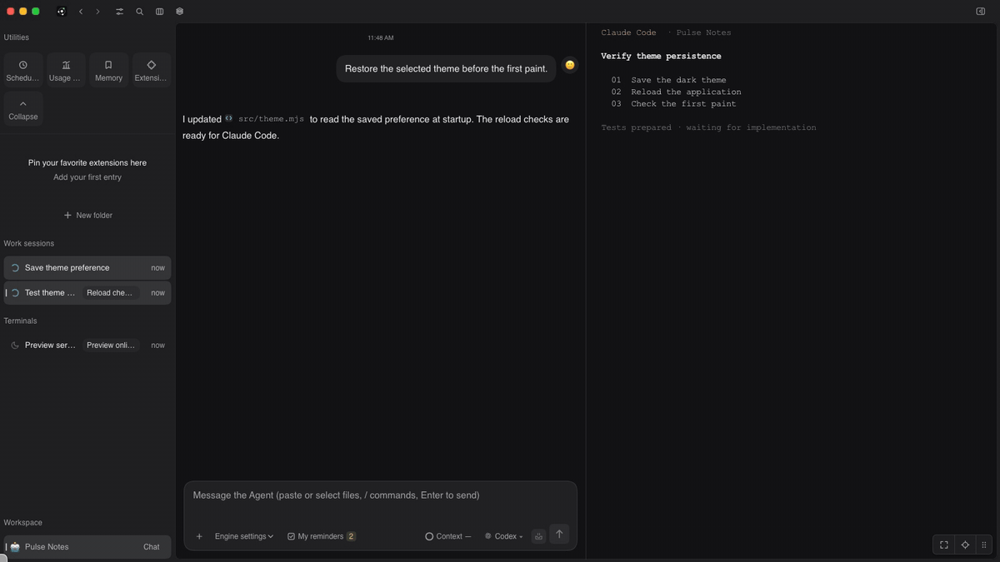
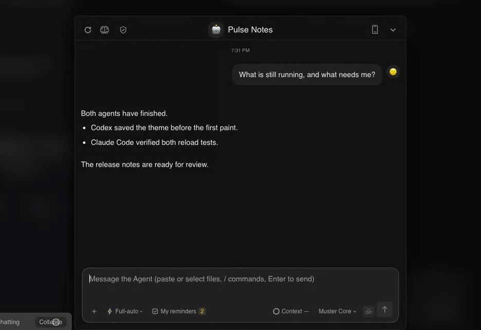
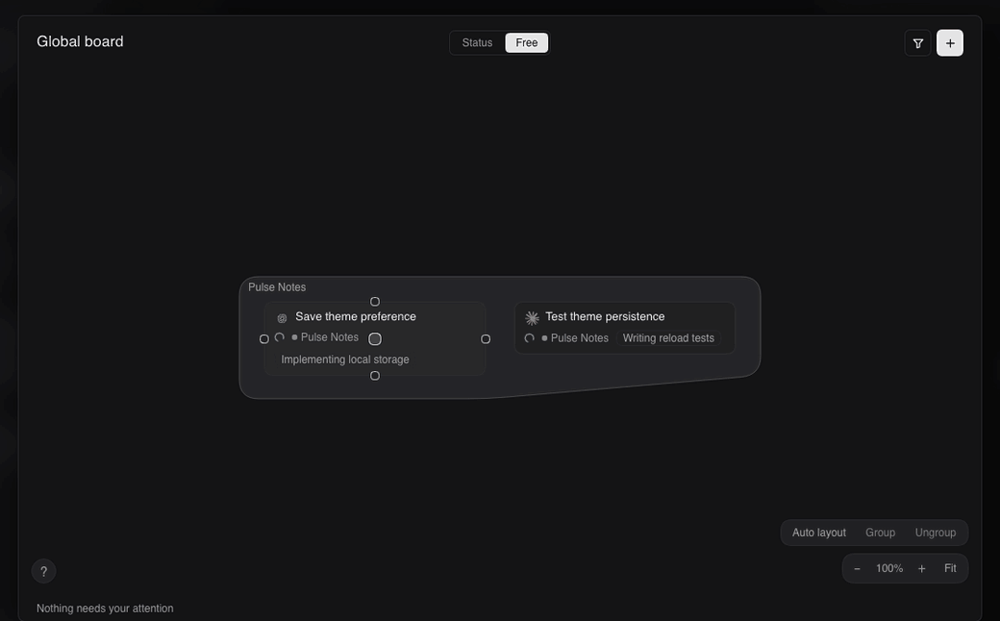
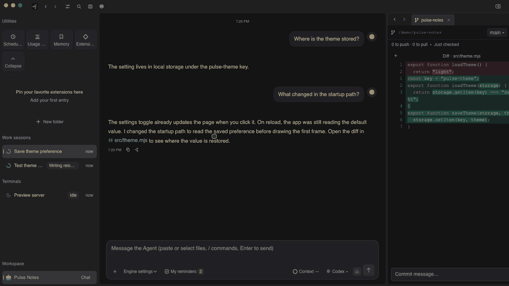
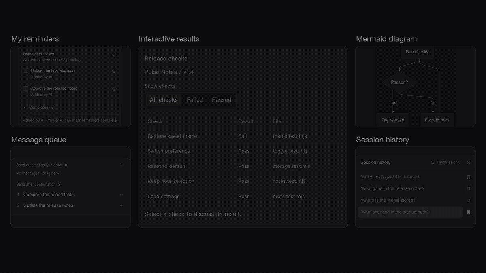

# Muster Console

<p align="center">
  <strong>Coordinate real coding agents from one cross-platform desktop workbench.</strong>
</p>

<p align="center">
  English · <a href="README.zh-CN.md">简体中文</a>
</p>

**Muster Console is a multi-agent desktop workbench for Windows, macOS, and Linux.** Use Codex and Claude Code side by side on the same project. Ask the Dispatcher Agent to split a task between them, then open the global board to see which sessions need your reply or review.

https://github.com/user-attachments/assets/154d3066-d57d-4552-9b4d-2044b2c100e9

*Meet the dispatchers for three workspaces, then follow Codex and Claude Code as they take assignments, work in split view, and exchange mail. Recorded in the Muster workbench with a demo project and scripted agent replies.*

[Audio credits](docs/media/readme/audio-credits.md) · [Cover image](docs/media/readme/en/muster-overview-v5.jpg)

## Coding agent harnesses

Choose a harness for each task. For example, ask Codex to implement a change while Claude Code writes the tests, and follow both sessions in the same workspace. The catalog includes **21 external harnesses**, among them Codex, Claude Code, Cursor, OpenCode, Gemini CLI, GitHub Copilot CLI, Kimi Code, and Qwen Code. Use an engine you already have installed and configured, or connect the built-in **Muster Core** to the model provider of your choice. When you create a task, choose its engine and working directory. Depending on the engine, you can work in chat or in its native terminal.

## Dispatcher Agent

Each workspace has its own dispatcher chat. Describe a goal in your own words, and the Dispatcher Agent can break it into tasks, open sessions, and assign the work to different agents in parallel. You can name the agent you want or configure a pool of harnesses for each task difficulty level and let the dispatcher choose.

Ask the dispatcher, “What’s still running, and what’s waiting for me?” It can check each session’s status and latest reply to give you an update.

### Talk to dispatchers side by side

Hover over the **Workspace** heading in the sidebar and select **Expand workspace chats side by side**. Each open workspace gets its own column and message box. Ask one dispatcher about a failing test while another reports on a release, with both conversations in view.

### Watch agents exchange mail

Agents can send each other API changes, test results, or file paths through their session mailboxes. Open both sessions in split view to watch the sender’s letter fold into an envelope and fly out as the recipient’s envelope arrives and opens.



### The dispatcher’s phone and apps

Select the phone icon in the upper-right corner of the desktop dispatcher panel to open **My apps** for the current workspace. When the dispatcher creates or updates a record from chat, the phone can open the corresponding page automatically. Edit the record there, and the dispatcher will see your changes the next time it reads it.

- **Todo and Reminders.** Ask the dispatcher to record the next step and due date for a to-do. You can also attach a one-time or recurring reminder to an item.
- **Channel.** Link a messaging channel to the workspace so the dispatcher can search across sources such as project email and Feishu group chats. It can send messages in conversations where you’ve granted it permission to reply.
- **Reading.** Subscribe to RSS or Atom feeds, read and save articles in the app, or ask the dispatcher to summarize updates on topics you follow.

You can also ask the dispatcher to build an app for your project. An equipment checkout log, for example, can track each device, who borrowed it, and whether it’s been returned. Record a return in the app, or ask the dispatcher, “Which devices are still on loan?” You can share the app through the local app library for other workspaces to install. Each workspace keeps its own records. [Dispatcher phone apps](docs/features/agent-apps.md)



## Global board and free canvas

The global board can show just the current workspace or sessions from several projects. Save work you haven’t started as a to-do. Sessions waiting for an answer or sign-off appear in the **Needs you** column. Select a card to return to its chat or terminal.

Switch to the free canvas to arrange related sessions, draw connections between them, or leave a sticky note beside a session. When you hand off work from an existing session, the next agent receives a new task brief and can refer back to the original conversation.



### Write to a CLI and follow its output

Expand the workbench input box in a CLI session to compose a multiline prompt. When the agent prints a file location or URL, select **Scan screen** to open it directly from the terminal output.

## A feature-rich right panel

**The horizontal virtual screen keeps the conversation and the right panel visible together, with both layouts stable as you shift focus.** Hover over or click the other side, and the two panes slide sideways together to reveal more of the one you’re reading. Each pane keeps its own width, so paragraphs wrap at the same words and code stays in the same place within the pane. Look from an explanation on the left to a change on the right, then pick up at the line where you left off.



- **Git worktrees and code review.** Give parallel tasks their own Git worktrees. Select a repository in the right panel to review its changes file by file. Comment on a line to send the agent your feedback along with the file path, line number, and original code. After review, you can accept and merge an isolated task from the board. In **Git → PR**, connect your GitHub account and grant the built-in Muster Console App access to your repositories. You can then open pull requests from a worktree, see checks and discussions, and submit reviews.
- **Built-in browser.** Open a website or a local development server alongside the conversation. On the bookmarks page, use ↑ and ↓ to select an item, → to enter a folder, ← to go back, and Enter to open the selected page. Tabs opened by an agent stay with its session, so several agents can inspect different pages at the same time.
- **File previews.** Open Markdown files, PDFs, or images from the file tree to read a formatted document or discuss a design with the original image in view.

## Project memory and extensions

- **Keep track of project decisions.** Use the Memory Center to trace a decision back to the discussion it came from, and update the record when a project convention changes. Turn frequently used review steps into a project skill for future tasks.
- **Extend the workbench.** Install an extension from the Extension Center or load one you’re developing locally, then choose which workspaces use it. Extensions can add custom panels and toolbar actions or connect tools through the Model Context Protocol (MCP). In the film, a daily report, a cube practice room, a code animation gallery, and a media desk run side by side. [Extension Center](docs/features/extension-center.md)

## Scheduled tasks and remote access

- **Schedule recurring work.** While the workbench is running, you can have an agent summarize the week’s Git commits every Friday. Each run has its own history entry. Open the linked session to ask a follow-up question.
- **Reply from your phone.** With your phone and computer on the same network, scan the QR code on the **Remote access** settings page. Open a **Needs you** session in your phone’s browser to answer a question or respond to an approval request.

## The little things

- **My reminders.** When a task needs something from you, such as uploading the final version of an icon, the agent can add it to **My reminders** in that session. The count at the bottom of the message box shows how many items are still open. You or the agent can mark an item complete.
- **Interactive UI.** An agent can present an answer as an interactive table, chart, or set of choices. For example, ask it to turn a test report into a table. You can filter for failed tests, select one, and ask about that result. These views can appear inline in a graphical chat or in the panel to the right of a terminal session.
- **Queue messages to send later.** Select **Hold for confirmation** next to the send button to put a text or image draft in the session’s **Send after confirmation** queue. Drag drafts to reorder them or bring one back to the editor. After reading the current reply, choose which draft to send first.
- **Mermaid diagrams.** Replies render `mermaid` code blocks as diagrams. Ask an agent to draw an order’s state transitions, then follow the arrows to see each branch. Open the diagram to zoom and pan.
- **Session history.** Right-click one of your own messages to open **Session history** and browse the conversation by question. Hover over an entry to preview the question and the end of that reply. Click to jump back to the exchange. Bookmark important questions and use **Favorites only** to find them again.



## Run from source

[Get Muster Console on GitHub](https://github.com/zhanghexie/muster-console)

Install Git, npm, and Node.js 24 LTS. Then clone the repository and start the workbench.

```bash
git clone https://github.com/zhanghexie/muster-console.git
cd muster-console
npm ci
npm run dev
```

On first launch, the desktop setup guide walks you through checking your tools, connecting a model, and creating a workspace and your first session. [First-run setup](docs/features/first-run.md)

Under **Settings → Harness integrations**, find the external agent you’ve installed and signed in to, then select it in **New task** to start your first session. To use the Dispatcher Agent or Muster Core, configure a model provider and default model under **Settings → Models & input**.

[Feature documentation](docs/README.md) · [Agent integrations](docs/features/gui-harness-integration.md) · [Platform packaging guide](docs/features/packaging.md) · [Contributing](CONTRIBUTING.md)

## License

Muster Console's own source code is licensed under MIT. Third-party components and media follow their respective licenses and attribution notices. [MIT License](LICENSE)
