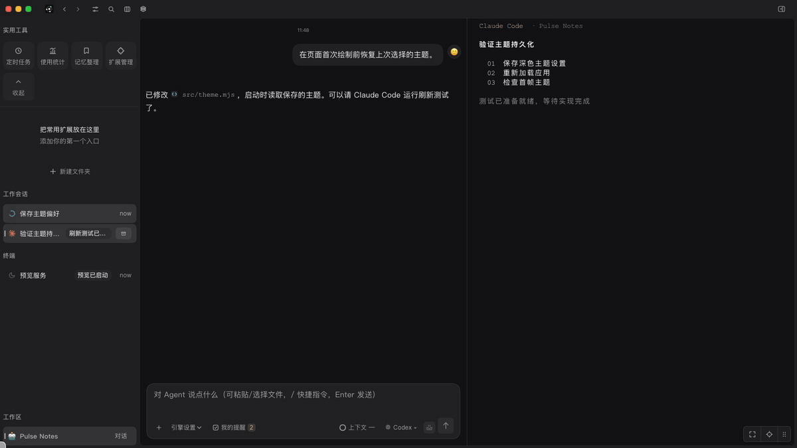
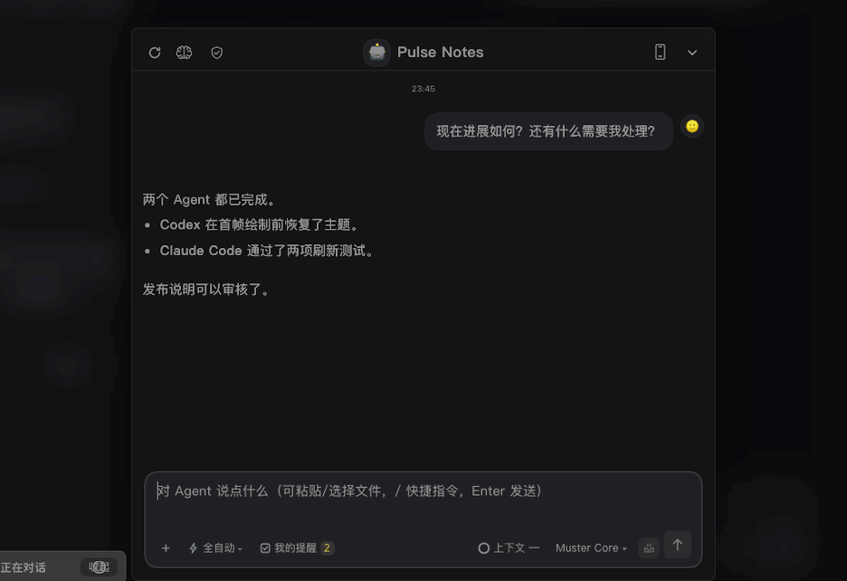
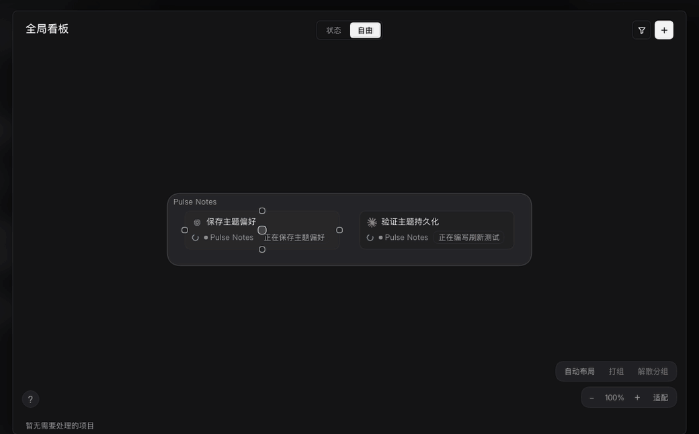
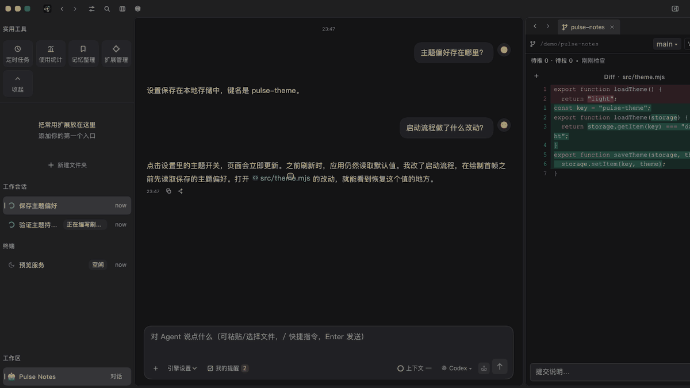
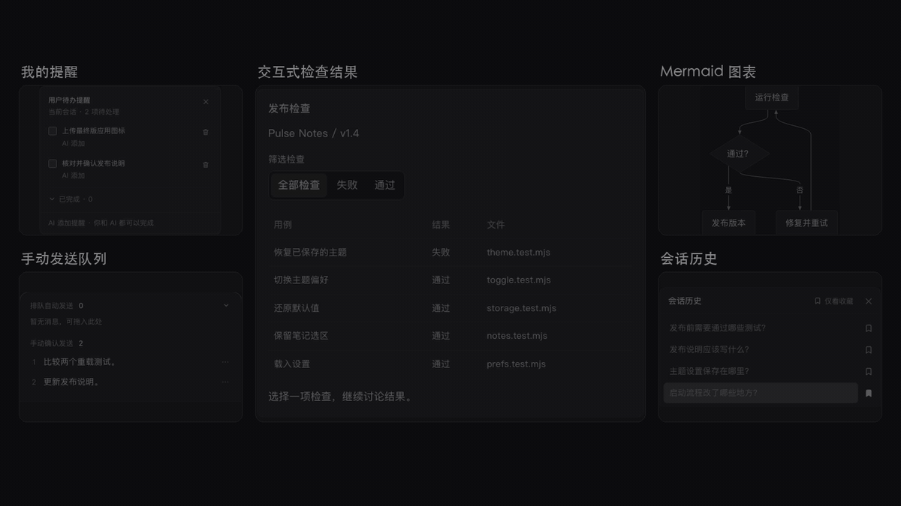

# 集序

<p align="center">
  <strong>在一个跨平台桌面工作台中，统一调度真正的编码 Agent。</strong>
</p>

<p align="center">
  <a href="README.md">English</a> · 简体中文
</p>

**集序是面向 Windows、macOS 和 Linux 的多 Agent 桌面开发工作台。** 你可以在同一个项目里同时使用 Codex 和 Claude Code，让调度 Agent 把任务分给它们，再从全局看板进入需要你答复或审阅的会话。

https://github.com/user-attachments/assets/2af0a294-d4b0-46a4-91ca-97a42506f1a0

*片中从三个工作区的调度对话开始，跟随 Codex 和 Claude Code 接任务、分屏协作、互相寄信。画面录自 Muster 工作台，使用演示项目和预设的 Agent 回复。*

[音频署名](docs/media/readme/audio-credits.md) · [视频封面](docs/media/readme/zh/muster-overview-v5.jpg)

## 多种 Agent 引擎（Harness）接入

每项任务都可以选用不同的引擎。比如让 Codex 实现功能，同时让 Claude Code 写测试，在同一个工作区查看两边的进展。接入目录收录了 **21 种外部 Harness**，包括 Codex、Claude Code、Cursor、OpenCode、Gemini CLI、GitHub Copilot CLI、Kimi Code 和 Qwen Code。你可以继续使用本机已安装并配置好的引擎，也可以为内置的 **Muster Core** 选择自己的模型服务。新建任务时，选定引擎和工作目录，即可使用该引擎支持的聊天界面或原生终端。

## 调度 Agent

每个工作区都有自己的调度对话。你可以用自然语言提出目标，让调度 Agent 拆分任务、创建会话，交给不同的 Agent 并行处理。你既可以点名让某个 Agent 接手，也可以预先按任务难度配置候选引擎，让调度据此选择。

想知道「哪项工作还在跑，哪项在等我确认」，可以直接问调度 Agent。它能查看各会话的状态和最近回复，帮你汇总进展。

### 同时和多个工作区的调度对话

将鼠标移到侧栏的「工作区」标题上，点击「展开并排对话」。每个已打开的工作区各占一列，有独立的输入框。你可以在一列追问哪个测试失败了，同时查看另一列调度发来的发布进展。

### 看两个 Agent 收发信

Agent 可以通过会话邮箱互相传递接口变更、测试结果或文件位置。把收发双方的会话分屏打开，就能看到寄件方的信纸折起、装入信封飞出，收件方的信封飞入、展开成信纸。



### 调度的手机与 App

点开桌面调度面板右上角的手机图标，就能看到当前工作区的「我的应用」。调度 Agent 在对话中创建或更新记录时，面板可以自动打开对应页面。你可以直接接手编辑，调度下次查询时也能看到你的修改。

- **待办与提醒。** 让调度记下待办的下一步和截止时间，也可以为某条待办设置一次性或重复提醒。
- **Channel。** 将消息渠道绑定到工作区后，调度可以跨来源搜索项目邮件、飞书群聊等内容，并在获得回复权限的对话中发送消息。
- **阅读。** 订阅 RSS 或 Atom 信息源，在 App 里阅读、收藏文章，也可以让调度按你关心的主题汇总更新。

你还可以请调度为项目做一个 App。例如，做一份设备借用登记，记录设备、借用人和归还状态。你可以在 App 里登记归还，也可以直接问调度「哪几台设备还在外借」。自制 App 可以共享到本机应用库，供其他工作区安装，每个工作区各自保存记录。[调度手机应用文档](docs/features/agent-apps.md)



## 全局看板与自由画布

全局看板可以只看当前工作区，也可以汇总多个项目。还没开工的任务可以先存为代办。等你答复或验收的会话集中在「需要你」一栏，点开卡片就能回到对应的对话或终端。

切到自由画布，你可以把相关会话放在一起、画线标出关系，或在旁边留一张思路便签。也可以从已有会话发起交接，让接手的 Agent 带着新的任务说明和可查阅的原对话记录继续工作。



### 在终端里写提示、跟进输出

在 CLI 会话中展开工作台输入框，就能编写多行提示。Agent 输出文件位置或网址后，点击「识屏」，可以直接从终端输出中打开对应文件或网页。

## 功能丰富的右侧栏

**横向虚拟屏让会话和右侧栏同时可见，切换阅读焦点时，两边的排版保持稳定。** 悬停或点击另一侧，两页会一起横向平移，让你关注的一侧多露出一些。每一页都保持原来的宽度，段落的换行和代码在页内的位置也和刚才一样。从左边的解释看到右边的改动，再把目光移回来，很容易接着刚才那一行往下读。



- **Git 工作树与代码审阅。** 并行开发时，可以为各项任务创建独立的 Git 工作树（worktree）。在右侧栏选中对应仓库，就能逐个文件查看差异，点选一行写批注，把文件路径、行号和原文连同意见发给负责的 Agent。审阅通过后，可以在看板上验收并合入隔离任务。在 **Git → PR** 连接 GitHub 并为内置的 Muster Console App 授权仓库后，可以从独立工作树发起 PR、查看检查和讨论、提交评审。
- **内置浏览器。** 在会话旁打开网页或本地开发服务，直接查看运行效果。在收藏主页按 ↑ 或 ↓ 选择条目，按 → 进入文件夹、← 返回上一级，按 Enter 打开选中的网页。Agent 打开的网页标签会跟随所属会话，多个 Agent 可以分别检查不同的页面。
- **文件预览。** 从资源树打开 Markdown、PDF 或图片，就能在右侧栏阅读排版后的文档，或对照设计原图讨论具体细节。

## 项目记忆与扩展

- **保留项目经验。** 在记忆中心查看一条项目决策来自哪次讨论，也可以在约定变化后修订它。常用的审阅步骤可以写成项目 Skill，供后续任务复用。
- **扩展工作台。** 从扩展中心安装扩展，或加载自己正在开发的本地扩展，再选择要在哪些工作区启用。扩展可以添加自定义面板和顶栏操作，也可以通过 MCP 接入已有工具。片中同屏演示了工作日报、魔方练习室、代码动画和媒体创作台。[扩展中心](docs/features/extension-center.md)

## 定时任务与远程访问

- **安排重复工作。** 工作台运行时，可以让 Agent 每周五整理本周的 Git 提交。每次执行都有独立的运行记录，可以点开对应会话继续追问。
- **从手机回复。** 手机和电脑在同一网络时，扫描「远程访问」页的二维码，就能在手机浏览器里打开「需要你」的会话，回复问题或处理审批。

## 小细节

- **我的提醒。** 遇到需要你做的事，例如上传最终版图标，Agent 可以把它记进当前会话的「我的提醒」。输入框底栏会显示待办数量，处理后你或 Agent 都可以标记完成。
- **交互式 UI。** Agent 可以把回答做成可操作的表格、图表或选择卡。比如让它把测试报告整理成表格，你可以筛出失败用例，选中一条，再围绕它继续提问。这些界面可以直接嵌在图形会话里，也可以在终端会话右侧的页面中操作。
- **手动排队发送消息。** 点发送按钮旁的「留待确认」，可将文字或图片草稿放进当前会话的「手动确认发送」队列。你可以拖动调整顺序、取回一条继续编辑，等看完本轮回复再决定先发哪一条。
- **Mermaid 文本绘图。** 回复中的 `mermaid` 代码块会直接显示为图表。比如，让 Agent 画出订单状态的流转过程，你就能沿着箭头查看各个分支。点开图表还可以缩放和拖动。
- **会话历史面板。** 在聊天里右键点击自己发过的消息，即可打开「会话历史」，按提问浏览当前对话。悬停条目可预览提问和该轮回复的结尾，点击就能跳回当时的位置。重要提问可以加书签，之后用「仅看收藏」快速找到。



## 从源码开始

[在 GitHub 获取集序](https://github.com/zhanghexie/muster-console)

准备 Git、npm 和 Node.js 22.22.2 或同系列更新版本，即可克隆仓库并启动工作台。

```bash
git clone https://github.com/zhanghexie/muster-console.git
cd muster-console
npm ci
npm run dev
```

首次打开桌面版时，按引导检查本机工具、连接模型，再创建工作区和第一条会话。[首次设置](docs/features/first-run.md)

在 **设置 → Harness 接入** 中检查已安装并登录的外部 Agent，然后从「新建任务」选择它，开始第一段会话。要使用调度 Agent 或内置的 Muster Core，在 **设置 → 模型与输入** 中配置模型服务商和默认模型。

[功能文档](docs/README.md) · [Agent 接入说明](docs/features/gui-harness-integration.md) · [各平台打包说明](docs/features/packaging.md) · [贡献指南](CONTRIBUTING.md)

## 许可证

集序自有源码采用 MIT 许可证。第三方组件和素材按各自的许可证与署名声明使用和分发。[MIT 许可证](LICENSE)
