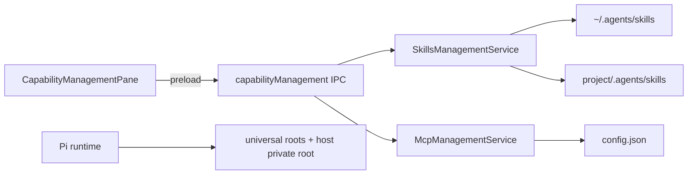

# 能力管理（Skills 与 MCP）

> 状态：实现说明（2026-11-07）
> 入口：`src/main/ipc/capabilityManagement.ts`、`src/shared/capabilityManagement.ts`、`src/shared/capabilityManagementApi.ts`、`src/renderer/src/components/settings/CapabilityManagementPane.tsx`

能力管理设置页分为 Skills、MCP、应用能力和宿主接入。Skills 与 MCP 使用全局/项目作用范围；IPC 只接受已注册 workspace 的项目根，所有写操作即时保存。

## Skills

Skills 清单只包含两个通用根：`~/.agents/skills` 和项目源根 `.agents/skills`。项目清单继承全局来源，多个项目源根按物理身份去重。同名来源进入差异审查，可保存偏好；正文编辑使用 expected hash，宿主公共技能和全局继承项只读。

设置页展示来源路径、状态、同名差异和使用策略。当前项目默认展开项目本地配置，全局继承项折叠为带数量的“来自全局”区；搜索、差异审查或手动展开时才显示继承项。全局条目在项目作用域只读，并提供跳转到全局管理；同名技能和被项目覆盖的 MCP 条目优先置顶。页面不再展示 harness 入口复选框、关联入口数量、原生目录状态、发现目录登记/取消登记按钮或品牌目录选择器。创建技能直接写入当前作用范围的通用目录；现有外部目录不会被自动搬迁或删除。

归并工具是显式的文件整理操作，不是运行时投递机制。它提供候选、目标、删除路径、链接路径、指纹和备份；用户确认后才执行，失败按事务清单恢复。宿主私有技能不允许归并。

## 宿主内置技能

宿主正文安装到 `~/.muster/skills`，由启动安装器维护，其中包括工具参数域以及 `muster-extensions`、`ui-widget-design` 两份宿主创作合同。设置页不把它当作普通用户来源；Pi GUI/dispatcher 在运行时通过显式路径加载该根。脚手架不再创建宿主技能目录链接，也不为品牌目录更新 `.gitignore`。

## MCP

MCP 管理仍维护宿主 `config.json` 中的全局和项目服务器配置，支持编辑、JSON 导入、删除、启用开关和连接测试。MCP 不按 harness target 分发，也不接管第三方 CLI 原生配置；会话通过宿主 relay 调用。

## 数据流

`SkillsManagementService` 负责扫描、物理身份、编辑和偏好；`runtimeSkills.ts` 将运行时加载路径接入 Pi；`skillSources.ts` 负责 worktree 映射、来源标记和去重。使用策略仍由 `CapabilityUsageService` 单独处理，不改变技能文件或发现根。

## 验证边界

`test/capability-skills-management.mjs`、`test/capability-skills-runtime.mjs`、`test/capability-skills-observation.mjs` 和 `test/host-domain-skills.mjs` 覆盖两个通用根、宿主私有根和观察行为。类型检查与离线测试只证明代码/模拟路径；没有 macOS/Linux 真机验收时，不把 Windows 结果写成跨平台验收。
