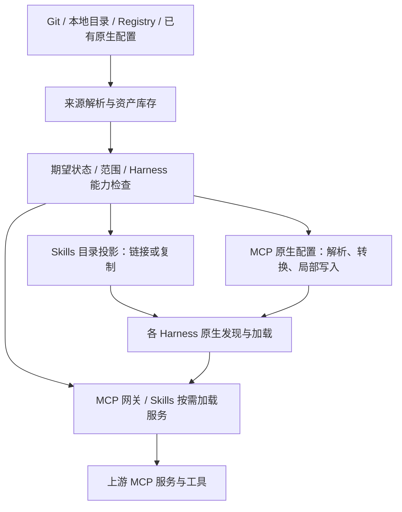

# 跨 Harness 的 Skills / MCP 管理：开源实现深研

调研日期：2026-11-06。研究对象是同时使用 Claude Code、Codex、Cursor、OpenCode、Pi 等工具时，如何统一管理 Skills 与 MCP。这里的 harness 指实际执行 Agent 的客户端/运行环境，CLI、桌面客户端、宿主 SDK 会话需要分别看待。

本次通过 GitHub 搜索筛选，浅克隆 12 个公开仓库，读取核心数据模型、安装/同步/删除路径与部分测试，并固定 commit。仓库元数据、最新 release 列表与三个函数级实验保存在证据目录。未安装候选应用、未执行它们的完整测试套件，未对 Windows/macOS/Linux 客户端进行运行验收。以下实现结论属于表中 commit；最新 release 仅证明存在发布，不自动证明主分支能力已交付。

## 1. 结论与阅读顺序

这些工具最常见的底座是 **统一资产模型 + Harness 适配器 + 文件系统投影 + 部署记录**。其中 Skills 主要处理目录/内容，MCP 主要处理结构化配置和凭证语义；两者可以共用管理界面，但不能共用一个简单的“复制文件”实现。

建议优先看以下源码：

| 想解决的问题 | 最值得先读 | 原因 |
|---|---|---|
| Electron / TypeScript 中统一管理 Skills 和 MCP | SkillBuddy | 已拆分 core / CLI / Electron，MCP 有规范模型、能力表、预览计划和受保护写入 |
| 一个技能真身，按 Agent 部署，保护已有文件 | Skills Manager | 目标状态分类和替换策略非常明确，CLI / GUI 共用核心 |
| 从 Git/URL 获取技能并安装到多个 Harness | Vercel Skills | 来源解析、发现、安装、锁记录完整；主分支新增程序 API，但发布包尚未包含它 |
| 成熟桌面产品的跨应用同步 | CC Switch | Skills 中央库、数据库和 MCP 各应用适配器；同时能看到不断增加特殊分支的维护成本 |
| 团队可重现安装、依赖和部署归属 | Microsoft APM | manifest / lock / 来源解析 / 部署账本 / 漂移重放分层明确 |
| 同一来源生成多种原生配置，并按需加载技能 | ai-rulez | 静态生成、字段归属 claim、漂移检查和 MCP 动态加载都已有实现 |
| 扫描各工具现有资产，再决定接管哪个版本 | mode-io Skill Manager、Skill Index | 先识别实际状态和差异，再选择统一来源 |
| 一个 MCP 出口供多个客户端连接 | MCPHub | 真正处于运行时，负责连接、身份、路由与调用；和配置同步是另一层 |

没有找到一个经过本次验证、可以直接替换上述全部层次的通用 SDK。更合理的组合是：分别选择获取分发、部署管理和运行时中转的实现。

## 2. 项目范围、许可和版本

Stars 是本次 GitHub API 快照，用于反映项目规模，不是质量或兼容性证明。完整 40 位 SHA 与 release 时间见 source-snapshot.json。

| 项目 | Stars | 技术 / 许可 | 本次源码 SHA | API 返回的最新 release | 定位 |
|---|---:|---|---|---|---|
| [farion1231/cc-switch](https://github.com/farion1231/cc-switch) | 152,318 | Rust + Tauri + React / MIT | `cd15a1642c5b` | v4.0.26，11-05 UTC | Skills + MCP 桌面管理 |
| [vercel-labs/skills](https://github.com/vercel-labs/skills) | 38,340 | TypeScript / MIT | `d3701c11b110` | v1.7.6，11-03 UTC | Skills 获取与安装，不管理 MCP |
| [xingkongliang/skills-manager](https://github.com/xingkongliang/skills-manager) | 7,312 | Rust + Tauri + React / MIT | `d30530c0ce47` | v1.43.3，11-03 UTC | Skills 库与部署，不是 MCP 管理器 |
| [microsoft/apm](https://github.com/microsoft/apm) | 4,257 | Python / MIT | `292004325893` | v0.35.0，10-22 UTC | Agent 资产依赖管理 |
| [intellectronica/ruler](https://github.com/intellectronica/ruler) | 2,961 | TypeScript / MIT | `5e551e60952f` | v0.3.46，10-22 UTC | Rules / Skills / MCP 项目生成 |
| [samanhappy/mcphub](https://github.com/samanhappy/mcphub) | 2,638 | TypeScript / Apache-2.0 | `1bdaf02e3428` | v1.2.1，11-03 UTC | MCP 网关与控制面，不管理 Skills 分发 |
| [Goldziher/ai-rulez](https://github.com/Goldziher/ai-rulez) | 167 | Go / MIT | `57bee3f37d8f` | v5.11.1，11-06 UTC | 多目标生成、治理与 Skills MCP 服务 |
| [konnga/skill-buddy](https://github.com/konnga/skill-buddy) | 129 | TypeScript + Electron + Vue / MIT | `8d1013f4fabf` | v0.1.15，10-29 UTC | Skills / MCP / instructions 工作台 |
| [getgaal/gaal](https://github.com/getgaal/gaal) | 57 | Go / AGPL-3.0 | `72da0a8a017d` | v0.3.0，05-25 UTC | YAML 声明与跨 Agent reconcile |
| [mode-io/skill-manager](https://github.com/mode-io/skill-manager) | 19 | Python 后端 + TS 前端 / MIT | `6ca969cbbc2e` | v0.3.1，05-19 UTC | 发现、接管和跨 Harness 管理 |
| [arjitj2/skillindex](https://github.com/arjitj2/skillindex) | 18 | TypeScript / Apache-2.0 | `47a3650fff0e` | v0.2.5，09-02 UTC | 本地资产盘点与统一来源 |
| [PhilippTh/agpack](https://github.com/PhilippTh/agpack) | 14 | Python / GPL-3.0 | `d8d7a50b708d` | v0.4.6，07-16 UTC | 通用资产与配置补丁分发 |

superpowers、anthropics/skills 等是内容包；awesome 列表和市场主要提供发现。本次不把它们当成跨 Harness 管理软件深研，以免把内容规模误当管理能力。

## 3. 三种架构，解决不同层次的问题

**中央库型**：CC Switch、Skills Manager 把资产真身与目标部署分开，数据库记录管理状态。适合个人桌面管理和按 Agent 开关。

**声明与生成型**：APM、ai-rulez、Ruler、agpack、gaal 从一份配置生成多个工具的原生文件。适合 Git 管理和团队初始化，但各自的更新/清理语义差异很大。

**运行时服务型**：MCPHub 接收真实 MCP 请求并路由；ai-rulez 的 served skills 则让 Agent 在运行中搜索和读取技能。配置同步成功并不证明已存在的会话刷新了配置，运行时握手成功也不证明技能被模型采用。

## 4. SkillBuddy：与 Electron 工作台最接近的分层

### 4.1 规范模型与原生配置分离

`packages/core` 包含扫描、聚合、适配、规划和格式 codec；`apps/desktop` 承担 Electron IPC、写入策略、计划保存和备份；`packages/cli` 为自动化入口。core 的 package.json 声明了 ESM 与类型 exports，但本次没有核实它是否作为独立 npm SDK 发布。[包边界][buddy-package]

MCP 没有只存一份任意 JSON。`McpServerDefinition` 描述 transport、command/args/cwd/env 或 url/headers；值被区分为 literal、环境变量引用、secret 引用。`McpConfigSource` 另记 agent、surface、scope、真实路径、格式、节点路径、来源和只读性。安装实例再关联这两者，并记录 definitionHash / sourceHash。[类型模型][buddy-types]

这样可以区分三件事：同一个服务定义、它在某客户端中的一份配置、以及该客户端支持什么。能力表明确 scopes、transports、OAuth、引用、toggle 及 protocol features；不会因为某 Agent 被发现就默认它能接收一切配置。

### 4.2 操作先规划，再写入

链路是：扫描 → 规范化 → 按目标能力投影 → 生成 blockers/warnings/requiredSecrets → 保存计划 → 用户应用 → 校验配置 hash → 备份 → 同目录临时文件与 rename。预览视图只暴露动作摘要，包含原文的 `McpPreparedMutation` 留在主进程内存。计划会过期；目标不支持传输、引用或写入时返回结构化错误。[规划与投影][buddy-operations]、[执行服务][buddy-service]

写入函数在写临时文件之前和提交之前两次比较 hash，保留文件 mode，对临时文件 fsync，再 rename；目录 fsync 在不支持的平台允许失败。[事务写入][buddy-transaction]

这个实现是**单文件替换加乐观并发保护**。执行服务逐 mutation 收集成功/失败，不是所有客户端一起提交或一起回滚；最后一次 hash 检查与 rename 之间也不能据此宣称具备跨进程原子 CAS。这是源码边界，不是本次发现了实际丢失更新。

### 4.3 Skills 同步有不同语义

其 `planAdditiveInstall` 只补目标缺项；`planImportSync` 是每个名字处理一次的导入，用户后续从目标删除也不会强制补回。它不是“源目录所有后续变化自动双向同步”。[Skills planner][buddy-planners]

**值得借鉴**：定义 / 来源 / 安装实例三层模型；目标能力决定能否投影；预览计划与执行原文分离；逐目标结果。其规模较小，不能因技术栈贴近就认定比成熟产品更可靠。

## 5. CC Switch：中央库 + 数据库 + 每应用适配器

Skills 服务明确以 SSOT 为真身，位置可选 `~/.cc-switch/skills` 或 `~/.agents/skills`。数据库保存安装来源、目录与应用开关。安装/更新后由 `sync_to_app_dir` 投影；Auto 尝试链接，失败回退 copy，WSL 路径另有直接使用 copy 的分支。[Skills 服务][cc-skill]

开关不是一个全局 enabled：`toggle_app` 面向具体 app，调整其文件和数据库状态；某些应用有暂存旧目标、提交数据库失败后恢复的专门路径。服务有读写锁，并明确锁顺序，下载完成后才进入保护文件和数据库状态的写锁。

MCP 由统一 `McpServer` 记录和各应用模块连接。以 OpenCode 为例：stdio 转 local；command 与 args 合并成数组；env 改为 environment；HTTP/SSE 转 remote。Codex 模块则读写 TOML，并从 command 或 url 推断传输。[MCP 总服务][cc-mcp]、[OpenCode 转换][cc-opencode]、[Codex 适配][cc-codex]

有两点不能笼统宣传：

- `sync_to_app_dir` 对 Claude Desktop 直接返回，不能由“应用出现在全局列表”推出 Skills 原生部署受支持。
- MCP 新增的一些应用使用 `sync_and_commit`，普通路径仍有先改数据库、后同步文件的顺序；不存在一个覆盖全部应用的统一事务保证。Skills 更新末尾也有记录某目标同步失败后继续的路径，中央库成功与每个目标成功需要分别表达。

**值得借鉴**：成熟的中央库存储、未托管资产扫描、应用开关与原生格式转换。**成本**：许多应用特例集中到长服务文件，接入数量增加时很容易产生不同的错误与提交语义。

## 6. Vercel Skills：来源解析与安装管线，注意发布差距

基本链路是来源解析 → 临时 clone/download → 找到 SKILL.md 包 → 选择 skill/target/scope → 安装 → 更新锁记录。`agents.ts` 描述目标目录；核心安装器处理 canonical 目录与目标路径、路径重叠、名字净化、链接和复制。[安装器][vercel-installer]

三种模式要分清：

- symlink：内容先复制到 canonical `.agents/skills/<name>`，目标 Agent 目录链接到 canonical。
- copy：直接复制到目标目录，不必经过 canonical。
- link：canonical 自身指向本地源，供本地编辑使用；不能与前一种模式混为一谈。

Windows 创建链接时使用 junction 和绝对目标，POSIX 使用相对链接；不能把同一条 symlink 命令当成全部平台实现。

项目 `skills-lock.json` 保存 source、可选 ref、skillPath、sourceType、computedHash 等。computedHash 来自整个技能目录的实际文件内容；`--frozen-lockfile` 比较该 hash 和 package version。**检测内容是否改变，和保证远端内容永远可重新获取，是两个承诺**：可移动的 branch/tag 加内容 hash 可以拒绝变化，但不等于留存了旧内容。需要确定提交时应显式 pin commit。[锁模型与校验][vercel-lock]

### 6.1 当前源码 API 与 npm 包不是同一能力

主分支 `src/index.ts` 已导出 `resolveSource / installSkills / listSkills / removeSkills / detectAgents` 等。API 文档明确无 terminal prompt/print/exit，支持 progress、warning、AbortSignal、显式 target；可以先 resolve 预览，再复用同一临时 source 安装，最后 dispose。源码有明确公共导出与 API snapshot 合同。[API 源码][vercel-api]、[API 文档][vercel-api-doc]

但本次查验 npm 最新 `skills@1.7.6` 元数据并在内存中读取 tarball：**没有 exports、types、main，也没有 API/index 产物，只有 CLI bin 入口**。npm gitHead 是 `7a5e920bead4b1039a6d6df5d7e1163b7b09423a`，不同于本次 main SHA。源码 package.json 仍标 1.7.6，单看版本字符串无法识别这个差距。[npm 版本元数据](https://registry.npmjs.org/skills/1.7.6)、本次发布产物核验

因此，旧报告“没有 library exports”对**当前主分支**已过时；“现在 npm install 就能调用这个 API”也不成立。当前可以评估固定 commit 的源码集成，或等待包含 API 的发布。该工具仍不管理 MCP；公共 API 也不是把所有 CLI 子命令都导出。

## 7. Skills Manager：最值得读的是目标归属判定

这是专门管理 Skills 的桌面工具，核心是中央内容库、SQLite 元数据和目标部署。CLI 与 GUI 使用同一套 store / commands / sync_engine；CLI 支持 JSON、dry-run 和结构化冲突结果，Agent 可以通过管理器操作，而不必绕过它直接改目录。[CLI 入口][sm-cli]

`sync_engine.rs` 对目标先做分类：

| 当前目标 | 意义 |
|---|---|
| Absent | 可以创建 |
| LinkToSource | 链接确实指向当前源 |
| ForeignLink | 其它链接或悬空链接，仍可能属于用户 |
| RealDir | 真实目录，无法仅靠外观判定是不是历史 copy |
| RealFile | 从来不是该工具正常部署的技能目录 |

调用方必须显式选择 `NoClobber / Recorded { mode } / UserConfirmed`。历史数据库记录不是当前磁盘状态的充分证明：记录说 symlink，磁盘现在是 real directory，不能据此递归删除。真正删除前重新分类，并按对象类型删除，避免把刚出现的真实目录当作旧链接处理。[状态和策略表][sm-sync]

平台实现也具体：POSIX symlink；Windows 先 symlink_dir，失败尝试 junction，再失败才 copy，并返回实际模式。这样数据库知道这次真正部署的是链接还是副本。metadata 可以导出到文件并从文件重建索引，内容 hash 用于识别变化。[元数据重建][sm-metadata]

**值得借鉴**：把“是否可覆盖”变成类型与决策表；真实部署模式入账；写入前再检查归属。记录模式匹配本身也不代表 copy 内用户修改得到完整保护，不能把这张表描述成所有内容冲突都不会丢失。

## 8. Microsoft APM：包管理器思路管理 Agent 资产

APM 管的不止 Skills，还包括 MCP 等资产依赖。当前安装管线拆为 resolve → targets → parallel download → sequential integrate → cleanup → lockfile → finalize。下载可以并行，集成按顺序进行，避免把网络并发和同目标文件写入并发混在一起。[安装管线][apm-pipeline]

锁文件记来源解析结果；部署账本另记目标 locator、owner 和内容 hash。`DeploymentMaterializationSession` 记录本次确实写入的内容证据，并与有效 owner 绑定，不能仅凭一个路径字符串就获得清理权限。更新计划用旧锁和新解析结果做差分；`--frozen` 对 manifest / lock 的约束与内容完整性策略是不同检查。[部署账本][apm-ledger]、[更新计划][apm-plan]

`drift.py` 会在隔离 scratch 中重放安装预期，再与实际部署比较；它能区分未托管目标冲突等情况。这比“DB 里 enabled=true 就显示正常”更接近真实状态，不过依赖缓存和解析证据，缺少确定 commit 等条件时会明确失败。[漂移重放][apm-drift]

MCP 是独立的 config-level lifecycle orchestrator，复用 client adapter / registry，不是把它硬塞进复制技能文件的 integrator。清理时还拒绝沿配置软链删除。[MCP 集成][apm-mcp]

需要特别限定“事务”：`InstallTransaction` 注释明确其 resolution journal 只覆盖 `apm_modules` 下的准备状态，**原生 target integrations 不在这个事务里**。不能由类名推出所有客户端文件都具备全局回滚。[事务边界][apm-transaction]

**值得借鉴**：来源锁定与部署归属分开；下载/集成分阶段；用重放检测漂移。若嵌入 Electron，会增加 Python 或独立二进制的交付成本；本次未验证它的全部 runtime target 与本仓兼容。

## 9. ai-rulez 与 Ruler：统一来源生成原生文件

### 9.1 ai-rulez 的两个交付面

静态面：`.ai-rulez` 内维护规则、技能、代理、命令、hooks、MCP 等，按 preset/profile 生成原生文件。以 Codex preset 为例，输出 AGENTS.md、技能目录和配置片段；`generate --check` / verify 检测生成漂移。[Codex preset][rulez-codex]

合并到用户配置时，`Claim` 记字段 path、数组元素 digest、可选值 digest、原有空父节点等。带 Sum/Equals 的 claim 只允许删除仍等于自己所写内容的值，用户改过的值保留；持久化 digest 而非复制可能含凭证的原值。[字段归属][rulez-claims]

注意这是 claim 能表达的保护：类型也允许只有 Path 的 claim，不能脱离实际调用方就宣称每项都有 digest 防护。

动态面：它已有 Skills MCP 服务，`find_skill` 对 name/triggers/keywords/description 做 BM25F 排序，`load_skill` 再加载正文；RoleScope 支持 domain/allow/deny 和 delivery，包含 session byte budget、资源读取与 identifier-only 加载遥测。[搜索排序][rulez-search]、[会话模型][rulez-state]

默认预算是 256 KiB **字节**，不是精确 token 配额。另有 exposure 对 Claude/Codex 初始上下文做模型化估计；MCP schema token 成本是用户配置的估算，不是实际握手测量。[Exposure 模型][rulez-exposure]

**修正旧结论**：不能继续说“所有外部管理器都不管加载预算/审计”。ai-rulez 当前源码已经做到了其中一部分，但它的预算、遥测和静态估计不能直接等同某个宿主的实际模型上下文。

### 9.2 Ruler 更像轻量项目生成器

Ruler 把 `.ruler` 的规则和配置传播到各 Agent，通过 `IAgent` 接口声明 stdio/remote/timeout/native skills 等能力。MCP merge 在服务器 map 层合并，同名 incoming 胜出；overwrite 则替换服务器 map，同时保留其它顶层设置。这不是字段级三方冲突合并。[Agent 接口][ruler-interface]、[MCP merge][ruler-merge]

Skills 记录 `.ruler-managed.json`，据此清理和重建自己部署的条目。当前代码明确只做 native skills propagation，不再走 Skillz MCP fallback；搜索结果里仍能看到旧版“其它 Agent 通过 uvx/Skillz MCP”的描述，应以当前代码为准。Skills 仍标 experimental。[Skills processor][ruler-skills]

适合团队把原始规则与资产纳入 Git，再生成项目配置；不等于具备中央桌面库、远端版本更新与运行时连接管理的完整产品。

## 10. 发现与接管：mode-io Skill Manager、Skill Index

mode-io 把 Harness 能力建模为 binding profile：Skills 是 FileTreeBindingProfile，MCP 是 ConfigSubtreeBindingProfile（格式、子树、codec、探测器），slash commands 则是 CommandFileBindingProfile。catalog 在同一个 HarnessDefinition 下组合这些能力，不要求每家支持所有 family。[Binding 合同][mode-contract]

MCP 先扫描现有各客户端配置，对同名服务的 command/args/env/url/headers 等结构做 hash。相同才产生 canonical_spec；不同就保留 sightings 供选择，并非先来者覆盖后者。[身份分组][mode-identity]

真正写 MCP 时用文件锁、解析文档、修改目标子树、原子写回；关闭按名字删除，兼容发现路径还可能涉及多个文件。该写入层不能直接套用它其它资产族的 hash/sync-state 保证，更不能把“身份 hash”误写成“删除前做归属 hash 校验”。[MCP adapter][mode-adapter]

其 README 的 Windows 范围比一些主分支实现更保守；最新 release v0.3.1 的资产只列 Darwin/Linux。本次没有证明新增 Windows 路径随已发布产品交付。[README][mode-readme]

Skill Index 采用用户拥有的 `~/.agents/{skills,agents,mcp.json}` 为统一来源，对已有版本做 Map / Compare / Standardize / Audit；插件缓存是只读候选，不能直接变为 canonical 链接目标。其 README 明确目前发布 macOS，Windows/Linux 与 project-level 配置仍在 roadmap。这里主要借鉴资产盘点和插件来源边界，未深入验证所有修复路径。[产品边界][index-readme]

## 11. 小型声明工具：agpack 与 gaal 的启发和具体边界

### 11.1 agpack：少量资源原语 + YAML target manifest

三类资源足以表达很多操作：copy-directory 负责技能包，copy-file 负责单文件，edit-file 负责 JSON/TOML 补丁。target manifest 给目的地和 `${bucket}`，同一 MCP 定义可以映射到 mcpServers / mcp_servers / mcp；真正不同的字段形状则需要 target 专用 patch。扩展一个工具主要改 manifest。[target 示例][agpack-target]、[部署管线][agpack-deployer]

锁文件记录已经部署的资源和 patch；patch value 保存 digest，避免把环境变量解析出的凭证写入锁。JSON 重新序列化可能改格式，TOML 使用 tomlkit；单文件临时写入/替换并不意味着整轮 sync 原子化。[补丁账本][agpack-lock]

**本次固定源码的清理语义**：replace 撤销直接删叶子，不保存也不恢复原值，且没有在删除前比较 expected_hash；append 才按 value hash 找到对应数组项再删除。搜索摘要里的“replace 恢复之前的值”与此不符。[清理函数][agpack-edit]

用原始纯函数做了三个内存实验，均通过断言：

| 输入场景 | 实际观察 |
|---|---|
| 管理器写入后，外部把 replace 目标改为别的 command，再撤销 | 外部改过的键仍被删掉 |
| 数组同时包含 user 项和匹配的 managed 项，撤销 append | 只删 managed 匹配项 |
| managed 数组项已被外部改过，撤销旧 append | 新值保留 |

复现脚本只 AST 提取原始纯函数，在内存对象上运行，不导入整个包、不装依赖、不改任何用户配置。脚本、结果

### 11.2 gaal：一个 YAML 驱动 reconcile

它以 gaal.yaml 声明 repositories / skills / content / mcps，注册表描述 Agent 路径，plan/status/doctor 与 sync 分离；MCP manager 解析目标 JSON/TOML 后 upsert，codec 保留其它顶层配置。[MCP manager][gaal-mcp]、[codec][gaal-codec]

**真实边界**：`Prune` 为每个目标算期望名字集合，删除其余所有服务器；源码明确手工添加、非 gaal 管理的条目也会被删。因此它适合声明独占管理的配置文件，不能直接用于需要保留外部配置的共享目录产品。它的普通 upsert 与 prune 有不同的保护范围。

以上两者的抽象都简洁，但 agpack 为 GPL-3.0、gaal 为 AGPL-3.0，不能沿用其它候选的 MIT 许可描述；源码借鉴与代码依赖需要分别选择。

## 12. MCPHub：统一出口，不是多份原生配置同步

MCPHub 接收下游客户端的 MCP 连接，自己创建上游 stdio / Streamable HTTP / SSE transport，发现 tools，并按 server/group 等路由真实调用。客户端只需连接网关端点；上游地址和凭证留在网关一侧。[transport 与调用服务][hub-service]

它必须解决配置同步工具不需要解决的运行时问题：session 生命周期、工具目录刷新、权限、OAuth、调用错误和子进程清理。源码为 session 创建下游 server，释放时清理隔离上游；`PrincipalRuntimeService` 用 serverName + username 缓存运行实例，credential revision 变化使旧实例失效，不跨身份复用带个人凭证的子进程。[身份运行实例][hub-principal]

这与“把同一 npx 命令写入多个客户端”不同：后者通常让每个客户端各自启动 MCP 子进程，并分别处理 OAuth/环境变量。网关可以集中管理，但引入服务可用性、会话隔离与协议能力转发的责任。MCPHub 不负责 Skills 文件安装，也不能代替原生配置加载的观察。

## 13. 可提炼的通用实现

以下是本次源码比较后的设计推论，尚未在本仓实施。

### 13.1 管理面至少需要五份不同的事实

| 模型 | 应记录什么 | 不该替代什么 |
|---|---|---|
| Source | Git/URL/本地来源、ref、resolved commit、完整包 digest | 不是一份目标安装 |
| Asset | Skill 包或规范化 MCP definition | 不是某个 Harness 的原生 JSON |
| Target profile | Harness、CLI/SDK surface、OS、scope、版本/能力 | 不是一个泛泛的“支持 Agent”布尔值 |
| Desired binding | 希望哪些目标得到哪些资产 | 不是磁盘已写成功 |
| Deployment / observation | 目标路径/节点、实际模式、last-applied digest、错误；必要时另记会话版本 | 不是模型已采用技能或真实工具调用成功 |

### 13.2 Skills 可以链接，MCP 应按语义投影

一个 Skill 是完整目录，链接能共享正文、scripts 和 references。MCP 通常只是一个共享配置文件中的子树，整文件链接会把其它设置一起共享，还会忽略各家 schema 和凭证插值差异。因此 Skills 优先研究包级链接/复制，MCP 研究规范模型、能力检查、局部字段写入或统一网关。

将 Skills 放入公共 `.agents/skills` 的代价也要表达：多个客户端可能天然都读取该目录，删除某个专属目录链接不一定让它不可见。**目标目录关联、宿主使用策略和外部 CLI 原生可见性是不同控制面。**

### 13.3 最重要的 reconcile 不是 write，而是 ownership

建议流程：扫描实际状态 → 比较 desired 与 last-applied → 生成计划 → 识别用户修改/外来链接/无权限 → 应用前重检 → 暂存与写入 → 读回验证 → 提交部署账本 → 逐目标回执。

需要分别测试：重新运行幂等；仅部分目标失败；预览后外部修改；原生配置格式损坏；链接被换为真实目录；用户更新了托管 copy；删除一个来源后仍有其它消费者；取消/进程崩溃后的残留。单文件 rename、合作式文件锁和跨文件事务分别提供不同保证。

### 13.4 对工作台的适用建议

先参考本仓现行 [Skills](../features/skills.md)、[能力管理](../features/capability-management.md)、[MCP 设置](../features/mcp-settings.md)。当前文档已明确 MCP 走宿主中转，第三方凭证不逐 Harness 复制；本次外部调研不构成恢复已退役原生部署的决定。

可以按独立能力借鉴：

1. **获取分发**：研究 Vercel 来源解析和未来发布的 API；在隔离 staging 获取完整技能包，再交给本仓管理层，不让依赖自行决定所有目标与 scope。
2. **资产与部署**：参考 Skills Manager 的目标状态表，APM 的来源/owner/部署证据分层，SkillBuddy 的预览与逐目标结果。
3. **既有配置差异**：参考 mode-io 的 sightings 与 canonical 选择，Skill Index 的插件只读来源；不要因为扫描到就自动接管。
4. **宿主运行时**：参考 MCPHub 的身份与连接生命周期、ai-rulez 的 search/load/预算/遥测；不要把安装数量或握手状态呈现成会话使用状态。

优先研究顺序：**SkillBuddy → Skills Manager → Vercel Skills → APM / ai-rulez → CC Switch**。前两者看分层与归属，Vercel 看获取，APM 看重现，ai-rulez 看生成和动态加载，CC Switch 看成熟桌面产品的适配经验。不是建议把它们全部作为依赖打包。

## 14. 验证、异常与未覆盖范围

- 已完成：12 仓库固定 commit；主路径静态追踪；最新 release 与许可元数据；Vercel npm tarball 内容核验；agpack 三个原始纯函数路径实验；文内固定 SHA 链接和本地证据。
- 查 release 时 CC Switch / APM 两个请求初次返回本地 URL 打开错误，随后重试成功；无候选因此被静默排除。
- 重要差距：Vercel main API 未进入最新 npm 包；APM 全局事务不能覆盖原生目标；gaal prune 可删除手工 MCP；agpack replace 不恢复旧值且不校验外部修改；Ruler 旧 Skillz 描述已不适用当前代码。
- Windows/macOS/Linux：部分项目确有对应发布资产或平台分支，本次均未真机验收。Skill Index 当前产品仅 macOS；mode-io 最新 release 无 Windows 资产，不能把主分支路径代码视为发布承诺。本文不把 Windows 机器上的源码阅读当跨平台测试。
- 没有验证：候选完整测试套件、发布二进制与全部主分支功能的逐项对应、所有 Harness 最新版本路径、私有仓库认证、真实 MCP OAuth/工具调用、正在运行会话的热刷新、云端同步冲突与性能。
- 本次只新增调研资料并更新目录索引，不改工作台运行代码、不安装候选到用户目录、不提交 Git commit。

## 源码定位（均固定本次 SHA）

[buddy-package]: https://github.com/konnga/skill-buddy/blob/8d1013f4fabf80e513a720ee85d0ca3fb73dd539/packages/core/package.json
[buddy-types]: https://github.com/konnga/skill-buddy/blob/8d1013f4fabf80e513a720ee85d0ca3fb73dd539/packages/core/src/mcp/types.ts#L17-L97
[buddy-operations]: https://github.com/konnga/skill-buddy/blob/8d1013f4fabf80e513a720ee85d0ca3fb73dd539/packages/core/src/mcp/operations.ts#L17-L105
[buddy-service]: https://github.com/konnga/skill-buddy/blob/8d1013f4fabf80e513a720ee85d0ca3fb73dd539/apps/desktop/src/main/mcp/service.ts#L254-L299
[buddy-transaction]: https://github.com/konnga/skill-buddy/blob/8d1013f4fabf80e513a720ee85d0ca3fb73dd539/packages/core/src/mcp/transaction.ts#L34-L100
[buddy-planners]: https://github.com/konnga/skill-buddy/blob/8d1013f4fabf80e513a720ee85d0ca3fb73dd539/packages/core/src/planners.ts
[cc-skill]: https://github.com/farion1231/cc-switch/blob/cd15a1642c5b414c78b8afa24d9bc36da35f1c8c/src-tauri/src/services/skill.rs
[cc-mcp]: https://github.com/farion1231/cc-switch/blob/cd15a1642c5b414c78b8afa24d9bc36da35f1c8c/src-tauri/src/services/mcp.rs#L235-L299
[cc-opencode]: https://github.com/farion1231/cc-switch/blob/cd15a1642c5b414c78b8afa24d9bc36da35f1c8c/src-tauri/src/mcp/opencode.rs#L44-L100
[cc-codex]: https://github.com/farion1231/cc-switch/blob/cd15a1642c5b414c78b8afa24d9bc36da35f1c8c/src-tauri/src/mcp/codex.rs
[vercel-installer]: https://github.com/vercel-labs/skills/blob/d3701c11b1101251af14c9d148f026e1a47ebe17/src/installer.ts#L235-L410
[vercel-lock]: https://github.com/vercel-labs/skills/blob/d3701c11b1101251af14c9d148f026e1a47ebe17/src/local-lock.ts
[vercel-api]: https://github.com/vercel-labs/skills/blob/d3701c11b1101251af14c9d148f026e1a47ebe17/src/index.ts
[vercel-api-doc]: https://github.com/vercel-labs/skills/blob/d3701c11b1101251af14c9d148f026e1a47ebe17/docs/api.md
[sm-cli]: https://github.com/xingkongliang/skills-manager/blob/d30530c0ce473bc7c74fdb5952ebc08f2097eff2/src-tauri/src/bin/skills-manager-cli.rs
[sm-sync]: https://github.com/xingkongliang/skills-manager/blob/d30530c0ce473bc7c74fdb5952ebc08f2097eff2/src-tauri/src/core/sync_engine.rs#L85-L159
[sm-metadata]: https://github.com/xingkongliang/skills-manager/blob/d30530c0ce473bc7c74fdb5952ebc08f2097eff2/src-tauri/src/core/sync_metadata.rs
[apm-pipeline]: https://github.com/microsoft/apm/blob/2920043258932f0f67e6f01df7b9047eb42f358c/src/apm_cli/install/pipeline.py#L378-L400
[apm-ledger]: https://github.com/microsoft/apm/blob/2920043258932f0f67e6f01df7b9047eb42f358c/src/apm_cli/core/deployment_ledger.py
[apm-plan]: https://github.com/microsoft/apm/blob/2920043258932f0f67e6f01df7b9047eb42f358c/src/apm_cli/install/plan.py
[apm-drift]: https://github.com/microsoft/apm/blob/2920043258932f0f67e6f01df7b9047eb42f358c/src/apm_cli/install/drift.py
[apm-mcp]: https://github.com/microsoft/apm/blob/2920043258932f0f67e6f01df7b9047eb42f358c/src/apm_cli/integration/mcp_integrator.py
[apm-transaction]: https://github.com/microsoft/apm/blob/2920043258932f0f67e6f01df7b9047eb42f358c/src/apm_cli/install/transaction.py#L83-L104
[rulez-codex]: https://github.com/Goldziher/ai-rulez/blob/57bee3f37d8f31f5647c41525460e49e52d4dcdd/internal/generator/presets/codex.go
[rulez-claims]: https://github.com/Goldziher/ai-rulez/blob/57bee3f37d8f31f5647c41525460e49e52d4dcdd/internal/generator/jsonmerge/claims.go#L18-L70
[rulez-search]: https://github.com/Goldziher/ai-rulez/blob/57bee3f37d8f31f5647c41525460e49e52d4dcdd/internal/mcp/serve_bm25.go
[rulez-state]: https://github.com/Goldziher/ai-rulez/blob/57bee3f37d8f31f5647c41525460e49e52d4dcdd/internal/mcp/serve_state.go#L16-L98
[rulez-exposure]: https://github.com/Goldziher/ai-rulez/blob/57bee3f37d8f31f5647c41525460e49e52d4dcdd/internal/config/types_exposure.go#L33-L60
[ruler-interface]: https://github.com/intellectronica/ruler/blob/5e551e60952fb1c81c6c5ad6f5fe8b7a412bda87/src/agents/IAgent.ts
[ruler-merge]: https://github.com/intellectronica/ruler/blob/5e551e60952fb1c81c6c5ad6f5fe8b7a412bda87/src/mcp/merge.ts#L45-L78
[ruler-skills]: https://github.com/intellectronica/ruler/blob/5e551e60952fb1c81c6c5ad6f5fe8b7a412bda87/src/core/SkillsProcessor.ts
[mode-contract]: https://github.com/mode-io/skill-manager/blob/6ca969cbbc2e6b9a0de719858a68b33b3c37844a/skill_manager/harness/contracts.py
[mode-identity]: https://github.com/mode-io/skill-manager/blob/6ca969cbbc2e6b9a0de719858a68b33b3c37844a/skill_manager/application/mcp/identity.py#L50-L113
[mode-adapter]: https://github.com/mode-io/skill-manager/blob/6ca969cbbc2e6b9a0de719858a68b33b3c37844a/skill_manager/application/mcp/adapters.py#L188-L226
[mode-readme]: https://github.com/mode-io/skill-manager/blob/6ca969cbbc2e6b9a0de719858a68b33b3c37844a/README.md
[index-readme]: https://github.com/arjitj2/skillindex/blob/47a3650fff0e89bc229be44a0effdd6a1545e528/README.md#L13-L101
[agpack-target]: https://github.com/PhilippTh/agpack/tree/d8d7a50b708d7caa61d33d7aa10fb8324d5082a8/agpack/builtin_targets
[agpack-deployer]: https://github.com/PhilippTh/agpack/blob/d8d7a50b708d7caa61d33d7aa10fb8324d5082a8/agpack/deployer.py
[agpack-lock]: https://github.com/PhilippTh/agpack/blob/d8d7a50b708d7caa61d33d7aa10fb8324d5082a8/agpack/lockfile.py#L40-L61
[agpack-edit]: https://github.com/PhilippTh/agpack/blob/d8d7a50b708d7caa61d33d7aa10fb8324d5082a8/agpack/kinds/edit_file.py#L170-L194
[gaal-mcp]: https://github.com/getgaal/gaal/blob/72da0a8a017d103d3f464b2e9982361accb628a2/internal/mcp/manager.go#L311-L358
[gaal-codec]: https://github.com/getgaal/gaal/blob/72da0a8a017d103d3f464b2e9982361accb628a2/internal/mcp/codec.go
[hub-service]: https://github.com/samanhappy/mcphub/blob/1bdaf02e34283c1cdaf0a9489ccc6c1775a79332/src/services/mcpService.ts
[hub-principal]: https://github.com/samanhappy/mcphub/blob/1bdaf02e34283c1cdaf0a9489ccc6c1775a79332/src/services/principalRuntimeService.ts#L15-L110
