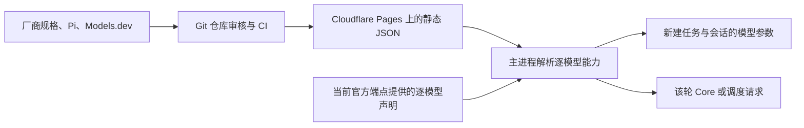

# 多模型 Harness 的思考选项与目录分发

调研日期为 2026-11-18。对照 Pi v1.4.0、OpenCode v2 源码、Crush 与 Catwalk v3，以及 DeepSeek Harness 的公开实现。

## 选型结论

建议用独立 Git 仓库维护 Muster 核验过的逐模型参数，CI 生成静态 JSON，由 Cloudflare Pages 分发。厂商结构化元数据、Pi 和 Models.dev 作为采集来源，维护者集中处理缺项和差异。客户端自动更新目录，用户选模型后直接看到该端点的原生选项。档位、默认值、开关和预算范围的变更可单独发目录，增加新的请求协议或控制形态需要客户端先支持。

目录条目对应**供应商、实际端点、调用协议和模型 ID**。以百炼 `qwen4-max` 为例，所列原生档位为 `low`、`high`、`xhigh`，但三种协议的请求字段分别是 `reasoning_effort`、`reasoning.effort` 和 `output_config.effort`。官方还公布了同义值。菜单可显示三个正式档位，兼容别名用于识别旧值，`xhigh` 与其他模型的 `max` 各自保留。 [百炼 Qwen4-Max 规格](https://help.aliyun.com/zh/model-studio/qwen4-max#思考强度)

## 现有工具对照

| 工具 | 目录怎么更新 | 思考参数怎么显示与发送 |
| --- | --- | --- |
| Pi v1.4.0 | 随包附目录，运行时从 `pi.dev/api/models/providers/{provider}` 拉分供应商的覆盖数据。普通目录有磁盘缓存、四小时刷新间隔和 ETag，`pi update --models` 可单独刷新。发布工作流生成并检查目录及版本兼容性，再发到 R2。 | 根据每个模型的 `reasoning` 和 `thinkingLevelMap` 筛选 Pi 的七种内部档位。`null` 去掉某档，`xhigh`、`max` 需要显式映射，其他基础档可由 SDK 补出。不受支持的选择会由 SDK 调整。各 API 实现按自己的方言组请求。 [远程目录](https://github.com/earendil-works/pi/blob/v1.4.0/packages/coding-agent/src/core/remote-catalog-provider.ts) · [档位解析](https://github.com/earendil-works/pi/blob/v1.4.0/packages/ai/src/models.ts) · [发布工作流](https://github.com/earendil-works/pi/blob/v1.4.0/.github/workflows/publish-model-catalog.yml) |
| OpenCode v2 | 独立的 Models.dev 仓库按供应商和模型维护 TOML，校验后生成 API。OpenCode 从 `models.opencode.ai` 读取 Models.dev v2 格式目录，随包附快照，后台用 ETag 刷新。 | `capabilities.reasoning` 分别表示支持思考、开关、枚举档和预算。OpenCode 按模型实际使用的 provider package 构造 variant，选择后参与组装请求。例如 DeepSeek 的档位同时下发思考开关和 effort，Responses 和 Gemini 各有实现。仅声明支持思考但没有具体控件时，不生成相应 variant。 [Models.dev 仓库](https://github.com/anomalyco/models.dev/blob/dev/README.md) · [OpenCode 刷新](https://github.com/anomalyco/opencode/blob/dev/packages/core/src/models-dev.ts#L505) · [档位到请求](https://github.com/anomalyco/opencode/blob/dev/packages/core/src/variant.ts#L12) · [使用文档](https://opencode.ai/docs/models/#variants) |
| Crush / Catwalk v3 | Catwalk 单独维护和发布 `/v3/providers`。Crush 支持切换目录源，按 ETag 读取，超时、离线或异常时使用本地缓存，再回落内置目录。 | 每模型用 `always`、`never` 或 `toggleable` 表示开关能力，强度项带值和显示名，保留默认强度。Crush 根据对应模型的档位校验用户选择。 [Catwalk v3](https://github.com/charmbracelet/catwalk/releases/tag/v3.0.0) · [Crush 缓存](https://github.com/charmbracelet/crush/blob/main/internal/config/catwalk.go) · [Crush 校验](https://github.com/charmbracelet/crush/blob/main/internal/config/config.go) |
| DeepSeek Harness | 第三方内置供应商用随安装提供的目录。自定义端点可以查询可用模型，DeepSeek 官方通道有自己的适配器和模型发现。 | 第三方内置模型继承已安装目录的档位，DeepSeek 官方通道由适配器提供档位。自定义模型可以补逐模型的参数映射，缺声明时菜单省略该项并沿用端点行为。 [供应商指南](https://github.com/deepseek-ai/deepseek-harness/blob/master/docs/user/guide/providers.md#reasoning-effort) · [DeepSeek 适配器](https://github.com/deepseek-ai/deepseek-harness/blob/master/packages/llm/llm-deepseek/README.md) |

Pi 的目录生成读取 Models.dev v1 的 `reasoning_options`，再结合自己维护的供应商规则生成 SDK 模型数据。构建产物已经做过协议转换，适合拿来发现已有参数和上游差异。其刷新逻辑会按整个模型条目覆盖内置数据，并要求 `Last-Modified` 新于随包目录时间。若直接把 Pi 的 `catalogBaseUrl` 指向自建服务，得同时复刻这个接口、响应头和完整模型格式。Muster 的菜单还要改用同一份能力数据才会跟着变。 [Pi 生成器](https://github.com/earendil-works/pi/blob/v1.4.0/packages/ai/scripts/generate-models.ts) · [Pi 覆盖逻辑](https://github.com/earendil-works/pi/blob/v1.4.0/packages/coding-agent/src/core/remote-catalog-provider.ts#L32)

Models.dev 的 v2 格式允许写默认值、开关、枚举、预算和按协议的兼容性。实际条目的完整度因模型而异，例如其 `gpt-5.5-pro` 条目有 `medium/high/xhigh`，厂商默认的 `high` 仍须从 OpenAI 规格补入。上游维护指南也允许根据同类托管端点推断中转模型的档位。若产品要求每项都有官方依据，应把这类推断当候选，发布时核对目标端点。 [Models.dev schema](https://github.com/anomalyco/models.dev/blob/dev/packages/core/src/schema-v2.ts#L144) · [维护指南](https://github.com/anomalyco/models.dev/blob/dev/README.md#file-format) · [GPT-5.5 Pro 条目](https://github.com/anomalyco/models.dev/blob/dev/providers/openai/models/gpt-5.5-pro.toml) · [OpenAI 规格](https://developers.openai.com/api/docs/models/gpt-5.5-pro)

## 官方数据如何补齐

| 来源 | 可自动消费的信息 | 需要补入的规格 |
| --- | --- | --- |
| DeepSeek 官方 `/models` | 逐模型的 `effort.supported_levels` 和已公布的 `effort.default_level` | `supported_levels` 只列思考开启时的档位。关闭的请求形态从实际协议文档确认。 [官方列表](https://api-docs.deepseek.com/api/list-models/) |
| Anthropic 官方 `/v1/models` | `capabilities.effort.<值>.supported`、思考模式与关闭支持 | 依型号和思考模式核对默认值与组合限制。 [官方列表](https://platform.claude.com/docs/en/api/models/list) · [能力说明](https://platform.claude.com/docs/en/models/overview#using-the-models-api) |
| OpenAI、Gemini、百炼 | OpenAI 列模型身份，Gemini 提供思考能力标记，百炼可以按推理能力筛选 | 根据逐模型文档和目标协议补枚举、默认值、开关以及预算范围。 [OpenAI 列表](https://developers.openai.com/api/reference/resources/models/methods/list) · [Gemini 列表](https://aistudio.google.com/api-reference/models) · [百炼列表](https://help.aliyun.com/zh/model-studio/list-models) |

公开目录描述通用规格，实际账户能访问哪些模型仍由当前服务商及凭据决定。厂商接口提供明确的逐档声明时，可以由主进程直接读取配置中的官方端点并缓存，目录仓库补足请求语义和缺项。通过企业网关、OpenRouter 或订阅套餐使用同名模型时，以该接入端点的规格为准。访问目录 CDN 不携带厂商凭据。 [OpenRouter 端点元数据](https://openrouter.ai/docs/api_reference/models#inspecting-provider-endpoints)

## 免费托管比较

| 方式 | 适用范围 | 取舍 |
| --- | --- | --- |
| GitHub 仓库 + Cloudflare Pages 静态文件 | 正式客户端的默认分发 | Git 集成支持合并后部署，静态资源支持 ETag、304 和回滚。Free 目前是每月 500 次构建、单文件最多 25 MiB，纯静态请求免费且不限量。几份 JSON 就能跑完整流程。 [Git 集成](https://developers.cloudflare.com/pages/configuration/git-integration/) · [缓存](https://developers.cloudflare.com/pages/configuration/serving-pages/#behavior) · [限额](https://developers.cloudflare.com/pages/platform/limits/) · [定价](https://developers.cloudflare.com/pages/functions/pricing/#static-asset-requests) · [回滚](https://developers.cloudflare.com/pages/configuration/rollbacks/) |
| GitHub Raw | 内部试用或允许按提交取历史版本的备用读取 | 直接读取公开仓库中由提交固定的文件，维护成本低。正式分发使用自己的地址可独立控制缓存和切换托管。若走 GitHub **REST Contents API**，匿名主额度是每来源 IP 每小时 60 次，该额度和 Raw URL 要分开看。 [固定提交](https://docs.github.com/en/repositories/working-with-files/using-files/getting-permanent-links-to-files) · [REST 限额](https://docs.github.com/en/rest/using-the-rest-api/rate-limits-for-the-rest-api#primary-rate-limit-for-unauthenticated-users) |
| GitHub Pages | 公开的文档、目录原型 | 仓库发布手续少。官方标注每月 100 GB 软带宽限制，并限制用 Pages 托管以商业交易或商业 SaaS 为主要目的的网站。 [使用限制](https://docs.github.com/en/pages/getting-started-with-github-pages/github-pages-limits) |

有长期域名时，可在其子域名上挂同一份 JSON，之后换 CDN 不需要迁移客户端地址。大陆用户的可达性和延迟要用真实网络验证，Cloudflare 的大陆网络是单独订阅，免费 Pages 属全球静态分发。客户端从本地读取上次成功的整份目录可以保持原有体验。 [Cloudflare 中国网络](https://developers.cloudflare.com/china-network/#availability)

## 对 Muster Core 的应用

1. **独立维护。** 可用 `muster-model-catalog` 作为仓库名，按实际提供服务的供应商维护条目，记录官方链接及最后核对日期。CI 从官方接口、Pi 和 Models.dev 拉候选或对照差异，校验 JSON、唯一身份、默认档合法性及请求适配形态后生成 `v1/reasoning.json`。对外静态文件包含 schema 版本、目录版本、发布日期和逐模型条目。后续 schema 改版可以并行分发，Catwalk v3 发布时保留 v2 接口就是同类做法。起步只维护推理参数及其端点身份，可以复用上游已有数据并集中维护缺项和修正。批量沿用上游代码或数据时保留对应许可声明。 [Catwalk v3 迁移](https://github.com/charmbracelet/catwalk/releases/tag/v3.0.0) · [Models.dev MIT 许可](https://github.com/anomalyco/models.dev/blob/dev/LICENSE)
2. **原生控件。** 目录分别表示厂商默认、关闭能力、原生枚举和 token 预算范围，允许模型只有开关或只使用默认。「跟随厂商默认」沿用端点的默认请求语义，实际支持省略时不发送对应字段；能关闭才显示「关闭」。枚举按官方顺序显示并原样发送，`xhigh` 与 `max` 可以同时存在。未知端点沿用可用的普通聊天路径，参数能力显示为未确认。用户只需正常接入并选择模型。
3. **同一份能力驱动 UI 与发送。** 主进程将选定的端点、模型、档位和目录版本一并交给回合；设置页、任务选择器、会话和调度查询同一份解析结果。已有 `ModelParameterContext` 能描述动态枚举，Core 需要移除硬编码五档作为菜单上限。有兼容形态时复用 Pi 的模型映射和请求实现；Pi 对当前模型发不出去的原生值、预算、开关组合由对应协议适配补齐。目录只承载受支持类型和值，连接地址、鉴权、工具、请求字段的组装规则仍来自应用及用户已有的连接配置。 [参数合同](../features/model-parameters.md#合同与入口) · [当前目录与请求](../features/model-providers.md#服务商模型目录刷新)
4. **自动刷新与兼容。** 首次打开读取包含版本号的静态 JSON，之后在后台低频条件刷新。当前目录可用时立即展示，离线或读取失败回落上次校验通过的目录或安装包快照。发布可以用 Git revert 后生成新版本回滚，客户端原子更新缓存；正在运行的回合继续使用其已解析版本。老会话显式选择按当前模型可证明的同义值迁移，失效档位需要在菜单里反馈。加模型和调整既有请求形态的值只发目录；引入新协议和新控件形态随客户端升级一次。 [现有静态分发经验](../features/extension-center.md#github-分发与凭据)

首批可用四类真实规格验证这条链路。DeepSeek 检查 `low/high/max`、显式关闭和省略 effort，OpenAI Responses 检查 `xhigh` 与已知默认，Anthropic 检查按模型与思考模式变化的 capability，百炼检查同一模型在多协议下的不同字段。再覆盖离线重启、HTTP 304、坏目录、回滚和同名网关，核对菜单选项与实际 SDK 请求体。部署后的公网可达性属独立验收。

## 验证记录

- 当前锁定的 Pi 1.4.0 在 `deepseek/deepseek-v4-pro` 内置数据里把 `low` 标为 `null`，只给出关闭、高、最高。DeepSeek 当前 API 文档的同 ID 示例明确给出 `low/high/max`，默认 `high`。安装快照的实际差异已复核，也是独立目录发布能解决的例子。 [厂商示例](https://api-docs.deepseek.com/api/list-models/)
- 用真实 `ModelRuntime` 和隔离的临时配置模拟目录 HTTP 请求。首次 `200` 的 fixture 为 DeepSeek 增加 `low`，再次条件请求收到 `304`。SDK 新增 `low`，离线重建后仍保留，SDK 的请求构造器生成 `reasoning_effort: "low"`。同一进程现有 Core 菜单解析仍返回关闭、高、最高。实验用构建器截取发送前请求体，并校验目录调用未带服务商凭据。
- 2026-11-19 读取 Pi 公开的 DeepSeek 与百炼 Token Plan CN 分片。普通聊天条目包含 `api`、`baseUrl`、`reasoning`、`thinkingLevelMap` 和 `compat`。百炼分片响应带 ETag 和 `Last-Modified`。锁定的 Pi 1.4.0 内置目录有 42 个供应商、1,599 条聊天模型记录，1,341 条声明支持推理且有非 `off` 的 Pi 档位。计数单位是供应商与模型的组合。 [DeepSeek JSON](https://pi.dev/api/models/providers/deepseek) · [百炼 Token Plan CN JSON](https://pi.dev/api/models/providers/qwen-token-plan-cn?types=chat)
- Core 已使用内置 Pi 目录及已配置服务商的公开分片，Pages 发布经核验的端点覆盖。百炼 `qwen4-max-preview` 公布 `low/medium/xhigh`，默认 `xhigh`。同为百炼端点的 `deepseek-v4.1-flash-1017` 按 Pi 声明显示 `low/high/max`，省略未核实的默认档。公开 Pages 的 `2026-11-19.1` 已校验包含两个型号。真实账号的推理响应未在本次回归中调用。 [百炼 Preview 规格](https://help.aliyun.com/zh/model-studio/qwen4-max-preview) · [Pi 的 1017 条目](https://pi.dev/models/qwen-token-plan-cn/deepseek-v4-1-flash-1017) · [Muster 发布目录](https://muster-model-catalog.pages.dev/v1/reasoning.json)
- 新版目录直接转换 OpenCode 使用的 Models.dev v2 聊天数据。处理同一模型在不同服务商及协议下的声明，按选中的请求形态保留真实枚举、开关及预算范围。硅基流动的 DeepSeek R1 使用 `thinking_budget`，Ollama 本地模型按 `/api/show` 运行时返回值处理。百炼官方说明 Preview 仅适用于 Token Plan，正式版在普通百炼保留 `low/high/xhigh`。 [OpenCode 数据入口](https://github.com/anomalyco/opencode/blob/dev/packages/core/src/models-dev.ts) · [硅基流动 API](https://docs.siliconflow.cn/docs/api/chat-completions-post) · [Ollama 思考能力](https://docs.ollama.com/capabilities/thinking) · [Muster 目录 v2](https://muster-model-catalog.pages.dev/reasoning-v2.json)
